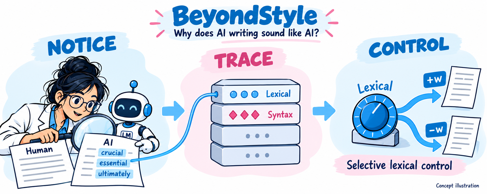
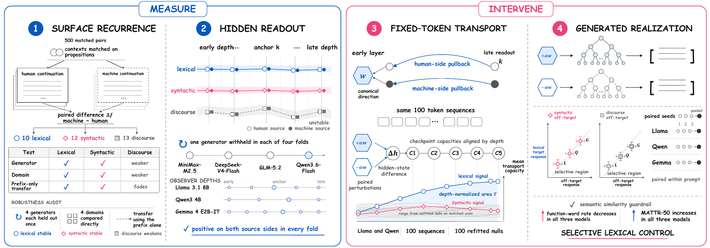
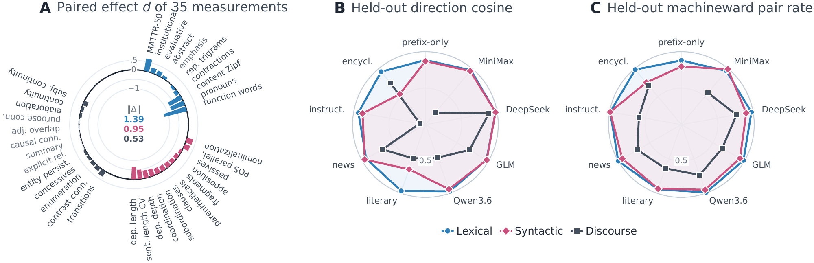
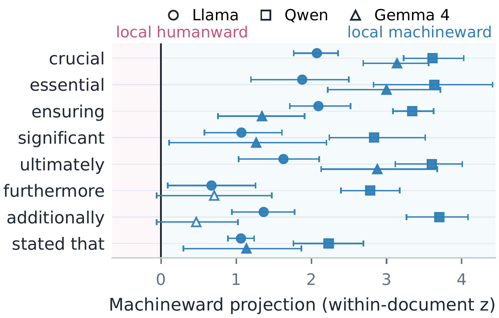
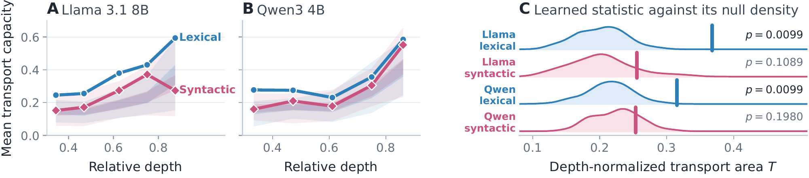
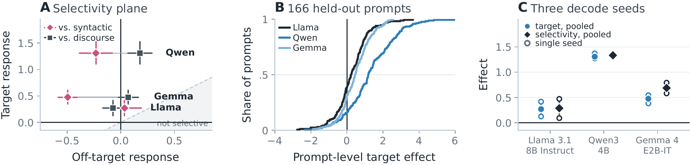

# BeyondStyle: style and control in machine-generated language

**Can the style we notice in AI writing be traced inside a model—and changed?**



## The question behind BeyondStyle

An AI-written passage can be fluent and factually correct yet feel formulaic. Readers notice familiar words, repeated sentence frames, and predictable transitions. Where do these habits come from? If they reflect a recurring pattern in how a model writes, can we find that pattern in its hidden states and use it to control generation?

We start with **500 content-matched human–machine continuation pairs**, balanced across four domains and four generators. Holding content close lets us study differences in expression. We measure 10 lexical, 12 syntactic, and 13 discourse properties and define a multivariate style signature from their combined differences. A separate prefix-only corpus tests whether the pattern persists without the proposition plan used during construction.

The central idea is to keep this text-defined target fixed throughout the investigation. We test whether it recurs across generators, whether hidden states predict its score for an unseen generator, whether an intervention carries it across layers, and whether it selectively changes newly generated text. A successful probe is one step in this chain, not the end of the argument.

[](assets/overview.pdf)

*The current paper overview, with a full-resolution PDF linked above. Transport is tested against 100 completely refitted null pipelines on identical token sequences; generation is tested on 166 held-out prompts with three paired seeds.*

<details>
<summary>中文概述：我们到底在研究什么？</summary>

AI 写出的文字即使通顺、准确，也可能让人觉得“有一股 AI 味”：一些用词、句式和过渡方式反复出现。我们希望弄清楚，这些表达习惯是否对应模型内部的某种方向，以及改变这个方向能否改变模型的写法。

我们先比较内容尽量一致的人类与机器文本，用词汇、句法和篇章测量定义风格差异，再始终围绕同一个目标进行检验：差异能否跨生成器复现，隐藏状态能否预测它，干预能否使其跨层传递，最后能否改变自由生成。

结果显示，词汇和句法都能被读出，但只有词汇通过了本文的固定 token 传输检验。词汇干预进一步在 Llama、Qwen 和 Gemma 中产生选择性变化：词汇得分的变化大于句法和篇章得分的变化。三个模型还共同表现出功能词比例下降、词汇多样性上升。这使“AI 味”的研究从观察文本中的表达习惯，走到了追踪并控制模型的生成行为。

</details>

## Key findings

### 1. A recurring style pattern spans ordinary language choices

Lexical and syntactic differences recur across generators, domains, and the prefix-only interface. The lexical signature combines function-word use, lexical diversity, word frequency, and other measurements. Discourse is less stable across these tests and remains an off-target measurement during generation.

[](assets/results/surface-signature.pdf)

The hidden-state analysis also gives concrete examples: **crucial, essential, ensuring, significant, ultimately, and stated that** lie on the machineward side of the contextual expression projections in all three observers. These are contextual measurements, not a claim that an individual word identifies AI authorship.

<details>
<summary>See the lexical-expression projections</summary>

[](assets/results/lexical-expressions.pdf)

The plot averages occurrences within documents and uses generator-held-out directions. The horizontal values are hidden-state coordinates, not word counts or probabilities that a text was written by AI.

</details>

### 2. Being readable does not guarantee causal control

Both lexical and syntactic scores can be predicted from hidden states of texts whose generator was excluded from fitting. Their intervention behavior differs. In Llama-3.1-8B-Instruct and Qwen3-4B, lexical transport exceeds all 100 refitted nulls; syntactic transport does not. The null pipelines repeat the fitting procedure after shuffling the linguistic correspondence, providing a test of whether the intervention tracks the declared style target.

[](assets/results/transport-null.pdf)

### 3. Lexical control carries through to generation

With layer and dose selected on development prompts, the frozen lexical intervention produces positive target and selectivity effects in **Llama-3.1-8B-Instruct, Qwen3-4B, and Gemma-4-E2B-IT**. Lexical changes exceed both syntactic and discourse changes. Two visible feature-level changes recur across the three families: function-word rate decreases and MATTR-50 lexical diversity increases.

Here, the **target response** is the lexical-score difference between positive and negative interventions. **Selectivity** subtracts the average syntactic and discourse response from that lexical change.

[](assets/results/generation-control.pdf)

| Model | Lexical target, mean [95% CI] | Selectivity, mean [95% CI] |
| --- | ---: | ---: |
| Llama-3.1-8B-Instruct | 0.269 [0.127, 0.412] | 0.287 [0.117, 0.459] |
| Qwen3-4B | 1.308 [1.103, 1.523] | 1.334 [1.098, 1.576] |
| Gemma-4-E2B-IT | 0.475 [0.348, 0.606] | 0.687 [0.552, 0.823] |

*166 held-out prompts and three paired seeds per model; intervals bootstrap prompts after averaging paired seed effects. These are corpus-defined score differences, not accuracy or human ratings. Layer/dose settings differ by model, so this table is not a model ranking. [Download the table](assets/results/generation-summary.csv).*

Together, these results connect a recurring lexical pattern in text to an internal intervention that selectively changes how the model writes. The paper reports English experiments; the separate Chinese research assets are not presented as a multilingual replication.

## Repository layout

```text
src/                    reusable data, feature, readout, steering, and
                        evaluation modules
scripts/                server-independent command-line entry points
assets/                 overview, promotional comic, and selected result figures
data/corpora/           pinned corpus registries
data/prefixes/          frozen natural-language prefix banks
data/paired/            frozen proposition-conditioned and prefix-only pairs
data/prompts/           document-disjoint development and test prompts
requirements/           runtime, analysis, evaluation, and test dependencies
lm_eval_tasks/          local lm-eval task definitions
tests/                  unit and integration tests
outputs/                generated artifacts; ignored except for its README
```

Manuscript sources, model weights, bulk experiment outputs, server provisioning
helpers, logs, and caches are intentionally excluded from the code repository.
Figure-building scripts for the current quantitative figures remain tracked.
Selected PDF figures and browser-friendly PNG previews are published in
`assets/`, while the manuscript tree stays ignored. The overview and promotional
comic are explanatory illustrations; the result figures come from the paper.

## Installation

Use Python 3.10 or 3.11. Install the PyTorch wheel appropriate for the local
CUDA driver first; the shared requirements deliberately do not replace it.

Download the review artifact above or clone the code repository, then enter
its extracted directory (shown here as `BeyondStyle`):

```bash
cd BeyondStyle

python -m venv .venv
source .venv/bin/activate
python -m pip install --upgrade pip
# Install a CUDA-compatible torch build here.
python -m pip install -r requirements.txt
python -m spacy download en_core_web_sm
python -m pip check
python -m pytest -q
```

The reproduction below starts from the tracked frozen corpora, so it does not
need a text-generation API. Copy `.env.example` to `.env` only when rebuilding
the paired corpus. Never commit `.env`, access tokens, or model weights.

Download the three observer models separately and place them under one
directory with these exact leaf names:

```text
$MODEL_ROOT/Llama-3.1-8B-Instruct
$MODEL_ROOT/Qwen3-4B
$MODEL_ROOT/gemma-4-E2B-it
```

Then set an absolute path and verify the runtime:

```bash
export MODEL_ROOT=/absolute/path/to/models
python scripts/check_environment.py
```

The semantic diagnostics also need two independent encoders. Download them
before running the offline audit scripts:

```bash
hf download BAAI/bge-base-en-v1.5 --local-dir "$MODEL_ROOT/bge-base-en-v1.5"
hf download sentence-transformers/all-MiniLM-L6-v2 --local-dir "$MODEL_ROOT/all-MiniLM-L6-v2"
```

BGE is used for corpus alignment and the matched Llama dose/baseline checks;
MiniLM is used for the cross-model paired-output diagnostic. The
`--model-path` option of `audit_generation_semantics.py` requires a downloaded
local directory, not a Hub identifier. These scripts use normalized
Sentence Transformers embeddings and cosine similarity. Similarity is an
automatic diagnostic, not a human judgment of fluency or unchanged meaning.

Dependencies are split into `requirements/runtime.txt` (inference),
`requirements/analysis.txt` (features, encoders, plots),
`requirements/evaluation.txt` (optional external benchmarks), and
`requirements/dev.txt` (tests). `requirements.txt` installs all four. The
version pins describe the supported environment, not a complete historical
record of every machine used for the experiments.

## Reproduce the English evidence chain

Run the command blocks in order from the repository root in Bash; later
blocks use `MODEL_ROOT` and the shell functions defined earlier. Numerical
outputs are written under `outputs/en/`. Preserve the manifests and runtime
records alongside them. Model inference requires separately obtained weights
and compatible GPU resources; the unit tests do not reproduce the GPU runs.

### 1. Surface signatures and interface transfer

```bash
python scripts/extract_linguistic_features.py \
  --language en \
  --dataset data/paired/en/proposition_aligned/pairs.jsonl \
  --out-dir outputs/en/05_linguistic/features \
  --bootstrap 2000 --permutations 5000 --seed 20260725

python scripts/extract_linguistic_features.py \
  --language en \
  --dataset data/paired/en/prefix_only_control/pairs.jsonl \
  --out-dir outputs/en/05_linguistic/prefix_only_control/features \
  --bootstrap 2000 --permutations 5000 --seed 20260725

python scripts/evaluate_prefix_only_transfer.py \
  --surface-only \
  --model-specs \
    Llama-3.1-8B-Instruct:7:32 \
    Qwen3-4B:8:36 \
    gemma-4-E2B-it:8:35
```

The feature-inventory sensitivity checks consume those two frozen feature
tables:

```bash
python scripts/analyze_feature_jackknife.py
python scripts/analyze_feature_subset_sensitivity.py
python scripts/analyze_feature_pca_sensitivity.py
python scripts/analyze_feature_redundancy.py
```

For the content-alignment diagnostic (including the source-stratified
mismatching control):

```bash
python scripts/audit_semantic_alignment.py \
  --model "$MODEL_ROOT/bge-base-en-v1.5" \
  --device cpu --bootstrap 10000 --null-permutations 1000
```

### 2. Hidden states and generator-held-out readouts

`run_hidden_formal.sh` is the only multi-model extraction wrapper retained in
the public repository. It is parameterized by `MODEL_ROOT` and does not assume
a scheduler, GPU number, cache location, or server filesystem.

```bash
MODEL_ROOT="$MODEL_ROOT" bash scripts/run_hidden_formal.sh en

for model in Llama-3.1-8B-Instruct Qwen3-4B gemma-4-E2B-it; do
  MODEL_ROOT="$MODEL_ROOT" \
    bash scripts/run_prefix_only_hidden_control.sh "$model"
done

python scripts/evaluate_prefix_only_transfer.py \
  --model-specs \
    Llama-3.1-8B-Instruct:7:32 \
    Qwen3-4B:8:36 \
    gemma-4-E2B-it:8:35
```

Build the source-consistent readouts at every depth used by the transport and
configuration analyses:

```bash
python scripts/build_concept_patterns.py \
  --states-root outputs/en/03_steering_vectors \
  --features outputs/en/05_linguistic/features/paired_feature_differences.csv \
  --out-dir outputs/en/05_linguistic/concept_patterns_layerwise \
  --representation mean_pool --holdout generator --null-k 10 \
  --groups lexical syntactic discourse \
  --model-specs \
    Llama-3.1-8B-Instruct:3 Llama-3.1-8B-Instruct:7 \
    Llama-3.1-8B-Instruct:11 Llama-3.1-8B-Instruct:15 \
    Llama-3.1-8B-Instruct:20 Llama-3.1-8B-Instruct:24 \
    Llama-3.1-8B-Instruct:28 Llama-3.1-8B-Instruct:32 \
    Qwen3-4B:3 Qwen3-4B:8 Qwen3-4B:12 Qwen3-4B:17 \
    Qwen3-4B:22 Qwen3-4B:27 Qwen3-4B:31 Qwen3-4B:36 \
    gemma-4-E2B-it:3 gemma-4-E2B-it:8 gemma-4-E2B-it:12 \
    gemma-4-E2B-it:17 gemma-4-E2B-it:21 gemma-4-E2B-it:26 \
    gemma-4-E2B-it:30 gemma-4-E2B-it:35
```

### 3. Jacobian pullbacks and fixed-token transport

The confirmatory transport configurations are Llama L7-to-L32 and Qwen
L8-to-L36. The following shell function only abbreviates repeated,
server-independent CLI calls:

```bash
build_transport_axis () {
  model="$1"; input_layer="$2"; anchor_layer="$3"
  layer_tag="$(printf '%02d' "$input_layer")"
  anchor_tag="$(printf '%02d' "$anchor_layer")"
  states="outputs/en/03_steering_vectors/$model/proposition_aligned/mean_pool"
  patterns="outputs/en/05_linguistic/concept_patterns_layerwise/$model/mean_pool"
  pullback="outputs/en/05_linguistic/causal_pullback/$model/mean_pool"

  python scripts/build_causal_pullback_directions.py \
    --model "$MODEL_ROOT/$model" \
    --pairs data/paired/en/proposition_aligned/pairs.jsonl \
    --states "$states/states/paired_states_layer$layer_tag.pt" \
    --input-directions-dir "$patterns/layer$layer_tag/directions" \
    --downstream-directions-dir "$patterns/layer$anchor_tag/directions" \
    --input-layer "$input_layer" --downstream-layer "$anchor_layer" \
    --max-pairs 32 --batch-size 1 --null-k 10 \
    --torch-dtype bf16 --attention-backend sdpa --seed 8236 \
    --out-dir "$pullback"

  python scripts/freeze_causal_pullback_axes.py \
    --source-checkpoint "$states/models/mean_diff_nullspace_layer$layer_tag.pt" \
    --lexical-checkpoint "$pullback/layer$layer_tag/directions/lexical.pt" \
    --syntactic-checkpoint "$pullback/layer$layer_tag/directions/syntactic.pt" \
    --sealed-prompt-start 34 --random-controls 8 --seed 8236 \
    --out-dir "$pullback/frozen_axes"
}

build_transport_axis Llama-3.1-8B-Instruct 7 32
build_transport_axis Qwen3-4B 8 36

for model in Llama-3.1-8B-Instruct Qwen3-4B; do
  MODEL_ROOT="$MODEL_ROOT" \
    bash scripts/run_canonical_behavior_model.sh "$model"
  MODEL_ROOT="$MODEL_ROOT" \
    MAX_PROMPTS=100 NULL_CONTROLS=100 \
    bash scripts/run_confirmatory_hidden_audits.sh "$model"
done
```

The fixed-token audit uses the same 100 token trajectories for the learned
directions and every null refit. `audit_pullback_matched_nulls.py` verifies the
trajectory hashes before comparing depth-normalized transport areas.

### 4. Held-out generation

Configuration selection uses prompts 0--19; prompts 20--33 remain unused; the
test uses prompts 34--199. The frozen generation settings are:

| Model | Intervention layer | Symmetric endpoint |
|---|---:|---:|
| Llama-3.1-8B-Instruct | 7 | 2.0 |
| Qwen3-4B | 22 | 3.0 |
| Gemma-4-E2B-IT | 3 | 0.25 |

These are the already-selected configurations, not a new search on the test
set. Replaying development-grid selection requires the separate per-cell
development runs and quality summaries consumed by the selection scripts;
the fixed-configuration commands below do not recreate those grids.

Build and freeze the three selected pullbacks under a separate root, then run
the untouched test. The commands are identical across architectures apart
from layer and endpoint values:

```bash
build_generation_axis () {
  model="$1"; input_layer="$2"; anchor_layer="$3"
  layer_tag="$(printf '%02d' "$input_layer")"
  anchor_tag="$(printf '%02d' "$anchor_layer")"
  states="outputs/en/03_steering_vectors/$model/proposition_aligned/mean_pool"
  patterns="outputs/en/05_linguistic/concept_patterns_layerwise/$model/mean_pool"
  root="outputs/en/05_linguistic/causal_pullback/$model/mean_pool/selected_generation"

  python scripts/build_causal_pullback_directions.py \
    --model "$MODEL_ROOT/$model" \
    --pairs data/paired/en/proposition_aligned/pairs.jsonl \
    --states "$states/states/paired_states_layer$layer_tag.pt" \
    --input-directions-dir "$patterns/layer$layer_tag/directions" \
    --downstream-directions-dir "$patterns/layer$anchor_tag/directions" \
    --input-layer "$input_layer" --downstream-layer "$anchor_layer" \
    --max-pairs 32 --batch-size 1 --null-k 10 \
    --torch-dtype bf16 --attention-backend sdpa --seed 8236 \
    --out-dir "$root"

  python scripts/freeze_causal_pullback_axes.py \
    --source-checkpoint "$states/models/mean_diff_nullspace_layer$layer_tag.pt" \
    --lexical-checkpoint "$root/layer$layer_tag/directions/lexical.pt" \
    --syntactic-checkpoint "$root/layer$layer_tag/directions/syntactic.pt" \
    --sealed-prompt-start 34 --random-controls 8 --seed 8236 \
    --out-dir "$root/frozen_axes"
}

build_generation_axis Llama-3.1-8B-Instruct 7 32
build_generation_axis Qwen3-4B 22 36
build_generation_axis gemma-4-E2B-it 3 35

run_selected_generation () {
  model="$1"; layer="$2"; strength="$3"
  root="outputs/en/05_linguistic/causal_pullback/$model/mean_pool/selected_generation"
  generated="outputs/en/03_steering_vectors/$model/proposition_aligned/mean_pool/selected_generation"
  analysis="$root/heldout_analysis"
  chat_args=()
  if [ "$model" = "gemma-4-E2B-it" ]; then
    chat_args=(--chat-template --chat-continuation-instruction)
  fi

  python scripts/run_steering_generation.py \
    --model "$MODEL_ROOT/$model" --language en \
    --representations mean_pool --dataset-tag proposition_aligned \
    --prompts data/prompts/en/formal.json \
    --components lexical --component-family causal_pullback \
    --component-root "$root/frozen_axes" --layer "$layer" \
    --strengths "-$strength" "$strength" \
    --prompt-start 34 --max-prompts 166 \
    --num-seeds 3 --base-seed 8236 --max-new-tokens 128 \
    --torch-dtype bf16 --attention-backend sdpa \
    "${chat_args[@]}" \
    --output-subdir selected_generation

  python scripts/analyze_seed_robustness.py \
    --input-dir "$generated" --out-dir "$analysis" \
    --model-id "$model" --direction-family canonical_pullback \
    --observational-features \
      outputs/en/05_linguistic/features/paired_feature_differences.csv \
    --components lexical --endpoint-strength "$strength" \
    --bootstrap 10000 --permutations 20000

  python scripts/analyze_generation_feature_inventory.py \
    --differences "$analysis/paired_component_differences.csv" \
    --observational-features \
      outputs/en/05_linguistic/features/paired_feature_differences.csv \
    --out-dir "$analysis/lexical_features" \
    --component lexical --group lexical \
    --bootstrap 10000 --permutations 20000
}

run_selected_generation Llama-3.1-8B-Instruct 7 2
run_selected_generation Qwen3-4B 22 3
run_selected_generation gemma-4-E2B-it 3 0.25
```

For the paired-output semantic audit, pass the generated directory above to
`audit_generation_semantics.py` and use the downloaded MiniLM directory:

```bash
python scripts/audit_generation_semantics.py \
  --input-dir outputs/en/03_steering_vectors/Llama-3.1-8B-Instruct/proposition_aligned/mean_pool/selected_generation \
  --out-dir outputs/en/05_linguistic/causal_pullback/Llama-3.1-8B-Instruct/mean_pool/selected_generation/heldout_analysis/semantics \
  --model-path "$MODEL_ROOT/all-MiniLM-L6-v2" \
  --components lexical --endpoint-strength 2 \
  --bootstrap 10000 --permutations 20000
```

Repeat the semantic command with the matching Qwen or Gemma paths and
endpoint. Additional baseline, calibration, and prompt-level analyses are
indexed in [`scripts/README.md`](scripts/README.md).

### 5. Contextual lexical projections

The lexical-expression figure requires token-level projections in addition
to the pooled readouts. Compute these after step 2, once for each observer:

```bash
for model in Llama-3.1-8B-Instruct Qwen3-4B gemma-4-E2B-it; do
  python scripts/analyze_token_projections.py \
    --model "$MODEL_ROOT/$model" \
    --dataset data/paired/en/proposition_aligned/pairs.jsonl \
    --states-root outputs/en/03_steering_vectors \
    --direction-scheme generator_holdout \
    --torch-dtype bf16 --attention-backend sdpa
done
```

These are hidden-state projections centered within continuations, not raw
word-frequency counts. The script records token-level shards, summaries,
and input metadata under `outputs/en/05_linguistic/token_projection/`.

### 6. Figures

After the numerical stages finish, regenerate the paper figures directly from
their CSV/JSON artifacts:

```bash
python scripts/plot_fig_surface_signature.py
python scripts/plot_fig_hidden_readout.py
python scripts/plot_fig_transport_null.py
python scripts/plot_fig_generation.py
python scripts/plot_projected_lexical_field.py
python scripts/plot_positive_generation_result.py
```

The scripts write vector PDFs under `ACL27/figures/` and raster previews under
`ACL27/build/previews/`. Those generated directories remain ignored; the
figure-building source code is tracked.

For the appendix transfer and pullback-sensitivity figures:

```bash
python scripts/audit_pullback_design_sensitivity.py \
  --model-ids Llama-3.1-8B-Instruct Qwen3-4B \
  --canonical-null-k 10 --canonical-fit-pairs 32
python scripts/plot_acl_evidence_figures.py --figures surface hidden
```

The hidden-robustness figure additionally requires
`causal_pullback/design_sensitivity/direction_sensitivity.csv` from the
design-sensitivity audit. Keep the `.work_pullback/` per-pair gradient shards
created with `--batch-size 1` in step 3; this audit reuses them without model
inference. The transfer figure uses the outputs from steps 1–2. Use
`--figures surface` if the sensitivity audit has not been run. The old
multi-layout story builder has been retired; each current figure now has
one documented entry point (see [`scripts/README.md`](scripts/README.md)).

Some readers retain fallback paths for the archived experiment outputs so
existing result records remain usable. A fresh reproduction should use the
canonical paths above. Data and code alone do not contain the large ignored
`outputs/` tree: complete the upstream stages before invoking a plotter.

## Data regeneration

The paired corpora and their manifests are tracked, so API regeneration is not
part of result reproduction. To rebuild them, configure an OpenAI-compatible
endpoint in `.env`, then inspect and run:

```bash
python scripts/download_hf_raw_datasets.py --help
python scripts/build_prefix_bank.py --help
python scripts/validate_prefix_bank.py --language en
python scripts/synthesize_paired_data.py --help
python scripts/synthesize_prefix_only_control.py --help
```

API generations need not be byte-identical. The committed pair files and
manifests are the frozen experimental inputs.

## Reproducibility invariants

- Surface targets are fitted without using free-generation outcomes.
- The evaluated generator is excluded from every nuisance, score, and readout
  fit in its fold.
- Human- and machine-side patterns are combined only when their orientations
  agree.
- Prompt prefill is unchanged; steering begins on generated-token forwards.
- Learned and null fixed-token runs reuse identical token trajectories.
- Null replicates rebuild the fitted pipeline after breaking only the
  linguistic correspondence.
- Generation inference resamples prompts after averaging paired seed
  differences within each prompt.

## Responsible use

The measured directions are corpus-conditioned contrasts, not authorship
detectors. They must not be used to accuse individual writers, adjudicate
misconduct, or penalize formal, non-native, neurodivergent, or technical
writing. Activation steering can also obscure machine provenance; deployments
should preserve provenance and disclose generated content where required.

## Data provenance and release status

[`data/README.md`](data/README.md) describes the frozen data and boundaries;
[`data/corpora/en.yaml`](data/corpora/en.yaml) records upstream identifiers,
revisions, license labels, and dataset-card links. Those records are not a
blanket license for the combined corpus or for generated outputs. Check each
source's terms, attribution requirements, and hosted-model output conditions
before redistributing or repackaging text. No license for third-party data is
granted by the paper's publication license.

The documented quality checks concern corpus structure and content alignment;
they are not a completed personal-information or offensive-content audit.
Public news and encyclopedic text may mention real people. Do not describe the
release as de-identified or safety-filtered without a separate documented
assessment. Human perceptual evaluation is not part of the reported study;
optional model-based evaluation scripts do not constitute human annotation.
