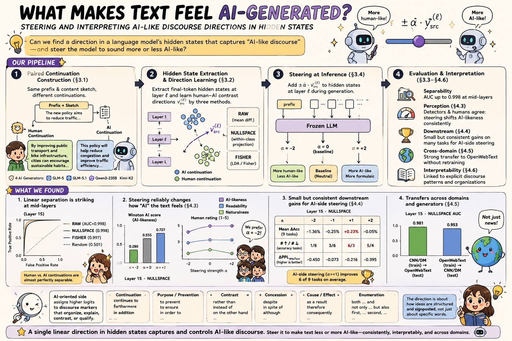
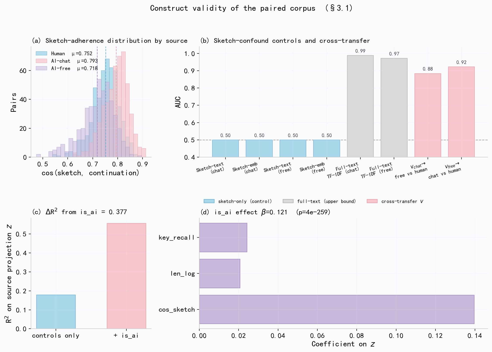
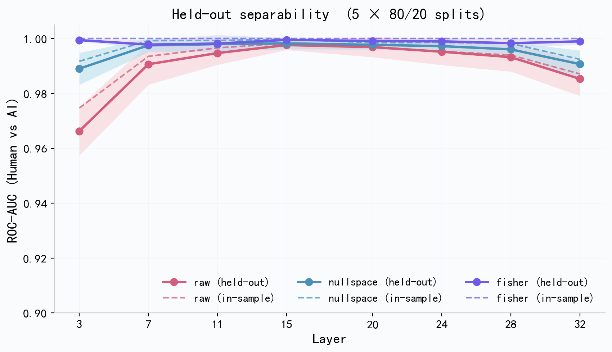
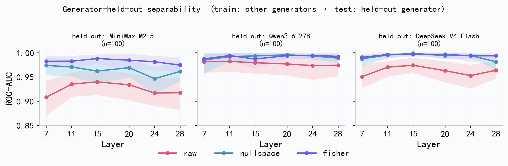
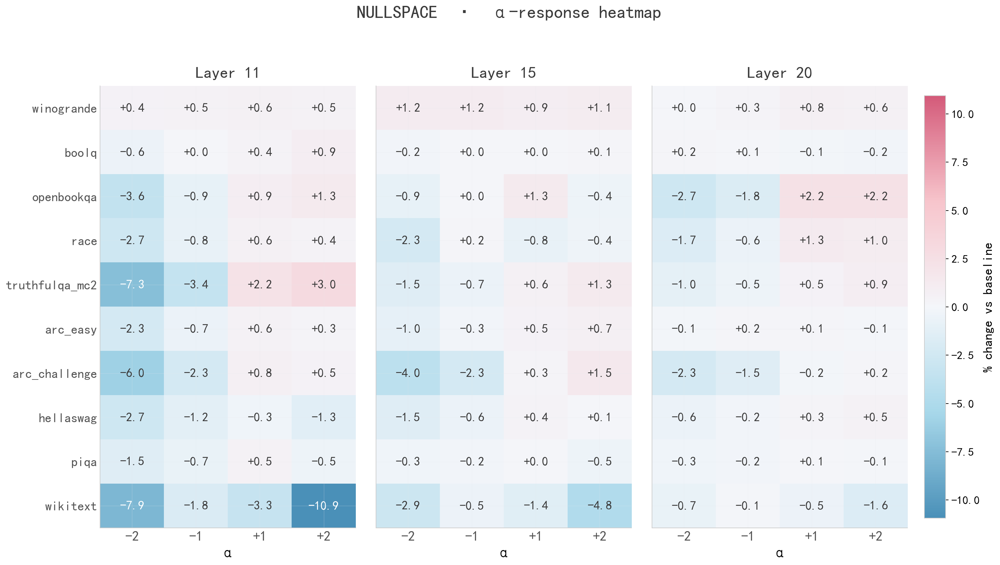

## 🧠 What Makes Text Feel AI-Generated?

### 🧭 Steering and Interpreting AI-Like Discourse Directions in Hidden States

BeyondStyle is the codebase for studying whether the recognisable "AI-generated" feel of LLM prose is represented as a direction in model hidden states. The project builds controlled human/AI continuation pairs, fits layerwise source-contrast directions in an open-weight target model, and tests whether those directions can separate, steer, and interpret AI-like discourse.

The central claim is intentionally scoped: the learned direction is not a universal detector or a fully disentangled authorship axis. It is an operational **AI-like discourse direction** under controlled continuation settings.

## 🔎 Approach at a glance

The pipeline starts from a shared prefix and compares two continuations: the original human continuation and an AI continuation generated under a coarse content sketch. The sketch controls topic and entities, but it does not prescribe wording, ordering, discourse markers, or rhetorical framing. This makes the paired corpus suitable for studying discourse realisation rather than only topic mismatch.



*🖼️ Figure: paired continuation construction, layerwise source-direction fitting, inference-time steering, and linguistic readouts.*

For each layer $\ell$, BeyondStyle extracts final-position hidden states from a frozen target model such as **Llama-3.1-8B-Instruct** and fits a unit vector $v_\text{src}^{(\ell)}$ pointing from the human side to the AI side. During generation, the model weights remain frozen; steering adds $\alpha v_\text{src}^{(\ell)}$ to hidden states at a selected layer. Positive $\alpha$ moves toward the AI side, while negative $\alpha$ moves toward the human side.

## 🛠️ Method

### 🧩 1. Controlled paired continuations

Each sample is a tuple $(p_i, c_i^H, c_i^A, \kappa_i)$: a shared prefix, a human continuation, an AI continuation, and a compact content sketch. The sketch is used only for constructing and auditing the pair; it is not included when hidden states are extracted. This design keeps local context comparable while leaving discourse choices unconstrained.

### 📐 2. Layerwise source-direction fitting

For every inspected layer, the repository compares three estimators:

| Estimator   | What it fits                                                 |
| ----------- | ------------------------------------------------------------ |
| `raw`       | Normalised human/AI mean difference.                         |
| `nullspace` | Mean difference after removing leading within-class variation. |
| `fisher`    | Ridge-regularised Fisher LDA direction.                      |

The direction is oriented so that AI continuations have larger projection scores than human continuations. Separability is then measured by projecting held-out hidden states onto this one-dimensional direction and computing ROC-AUC.

### 🎛️ 3. Inference-time steering

Steering is a lightweight intervention, not full weight fine-tuning of the LLM. Once a direction is fitted from hidden states, a forward hook adds the direction during decoding:

$$
\tilde h_t^{(\ell)} = h_t^{(\ell)} + \alpha v_\text{src}^{(\ell)} .
$$

The same prompts and decoding settings are used across steering strengths, so differences are attributable to the sign and magnitude of the hidden-state intervention.

### ✅ 4. Controls and interpretation

The paper audits whether the direction is reducible to sketch leakage, sketch adherence, length, shallow surface features, lexical n-grams, or generator-specific fingerprints. These checks support interpreting the direction as a source-associated discourse-realisation contrast rather than a simple artefact of the paired construction.



*🖼️ Figure: construct-validity checks show that the paired-corpus signal is not explained by sketch-only prediction or simple sketch-following behaviour.*

## 📊 Main results from the paper

### 🧠 Hidden states contain a strong human/AI contrast

On **500 paired CNN/DailyMail continuations** with **Llama-3.1-8B-Instruct**, source directions separate held-out human and AI continuations with near-ceiling ROC-AUC in middle layers. At layer 15, `raw` and `nullspace` both reach **0.998** held-out AUC, while `fisher` reaches **1.000**.



*🖼️ Figure: held-out human/AI separability is strongest in middle-to-late layers, where the main steering experiments are performed.*

### 🌐 The direction transfers across domain and generator pool

The direction is not confined to the original news corpus. Without refitting on the target domain, the layer-15 `nullspace` direction trained on the main English corpus reaches **0.975 AUC** on OpenWebText; the reverse OpenWebText -> original transfer reaches **0.994 AUC**.



*🖼️ Figure: OpenWebText generator-held-out evaluation remains strong across a disjoint generator pool, supporting transfer beyond a single generator fingerprint.*

### 🕹️ Steering changes perceived AI-likeness

At layer 15, steering along the fitted direction changes generated continuations in the expected signed direction. For the `nullspace` direction, Winston AI-likelihood moves from **0.555** at $\alpha=0$ to **0.280** at $\alpha=-2$ and **0.727** at $\alpha=+2$. GPTZero AI probability moves from **0.86** to **0.16** and **0.93**. Human ratings follow the same pattern: human-side steering lowers perceived AI-likeness and improves readability/naturalness, while AI-side steering does the opposite.

### 🧪 Open-model benchmark evaluation shows a small direction-specific response

The main downstream evaluation uses **Llama-3.1-8B-Instruct** with `lm-evaluation-harness` on nine accuracy tasks plus WikiText perplexity. The clearest positive pattern appears under mild AI-side `nullspace` steering. At $\alpha=+1$, accuracy improves on **8/9**, **6/9**, and **7/9** tasks at layers 11, 15, and 20, respectively. Same-norm random perturbations do not reproduce this pattern, while WikiText perplexity can worsen; the result is therefore interpreted as a local direction-specific behavioural response, not general capability improvement.



*🖼️ Figure: task-level response surface for `nullspace` steering. Mild AI-side steering gives the most consistent positive accuracy pattern, while human-side steering is often harmful.*

### 📝 Linguistic readouts explain the AI-oriented side

The AI side is not a single keyword list. English token, phrase, and construction readouts associate it with explicit explanation, salience marking, continuity, institutional/evaluative wording, and overt causal, purposive, concessive, or contrastive linking. The Chinese interpretability check with **Qwen3-4B** shows compatible discourse-level evidence: explicit progression, evaluative emphasis, broad explanatory framing, and purposive or contrastive linking.

## 🚀 Reproducing the open-model experiments

The checked-in paired datasets can be used directly for open-weight target-model fitting and evaluation. API-backed generators are only needed if you want to build new paired continuations.

### ⚙️ Setup

```bash
pip install -r requirements.txt
cp .env.example .env

# Set LOCAL_MODEL_PATH in .env, for example:
# LOCAL_MODEL_PATH=/path/to/Llama-3.1-8B-Instruct
python -c "from src.config import print_config; print_config()"
```

### 🧭 Fit source directions and run alpha-sweep generation

```bash
python scripts/steering_pipeline.py \
  --dataset data/paired/en/paired_mixed_500.json \
  --multi \
  --denoise raw nullspace fisher \
  --alphas -2 -1 0 1 2
```

This extracts hidden states from the local target model, fits the three source-direction estimators, and writes steered generations under `outputs/en/03_steering_vectors/`.

### 📏 Evaluate separability and open-model behaviour

```bash
# Held-out human/AI separability
python scripts/eval_heldout_separability.py --language en

# Leave-one-generator-out robustness
python scripts/eval_generator_holdout.py \
  --dataset data/paired/en/paired_mixed_500.json

# lm-evaluation-harness steering grid
python scripts/eval_lm_benchmark.py --mode grid --language en
```

The paper's open-model benchmark grid covers HellaSwag, ARC-Easy, ARC-Challenge, OpenBookQA, WinoGrande, PIQA, BoolQ, RACE, TruthfulQA-MC2, and WikiText.

### 🔁 Cross-domain transfer

```bash
python scripts/steering_pipeline.py \
  --dataset data/paired/en/paired_openwebtext_mixed_300.json \
  --multi \
  --denoise raw nullspace \
  --skip_generation

python scripts/eval_cross_domain_transfer.py
python scripts/eval_cross_domain_transfer.py --reverse
```

### 🌏 Chinese interpretability with Qwen3-4B

```bash
python scripts/steering_pipeline.py \
  --dataset data/paired/zh/paired_mixed_500.json \
  --multi \
  --denoise raw nullspace fisher

python scripts/run_interpretability.py --language zh
```

The Chinese analysis is intended as cross-linguistic interpretability evidence, not as a full replication of the English separability, steering, and downstream experiments.

## 📁 Repository layout

```text
src/                    Python package: config, data, extraction, steering, eval, visualization
scripts/                Pipeline entry points; each script supports --help
data/
  prompts/{en,zh}/      held-out generation prompts
  paired/{en,zh}/       paired human/AI continuation datasets
outputs/                result tree; artefacts are git-ignored except layout READMEs
paper/                  paper source and figures
assets/                 README figures copied from paper/figs
```

Outputs are organised as:

```text
outputs/{lang}/{section}/{model_id}/{dataset_tag}/...
```

For example, `mixed_500` and `openwebtext_mixed_300` are kept separate by dataset tag.